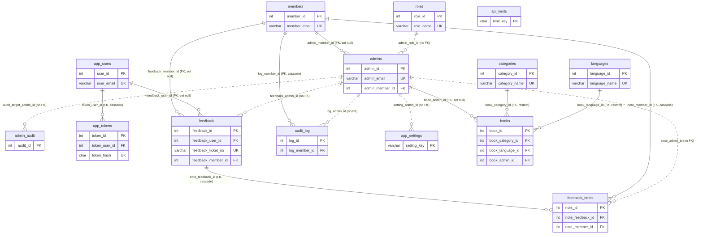
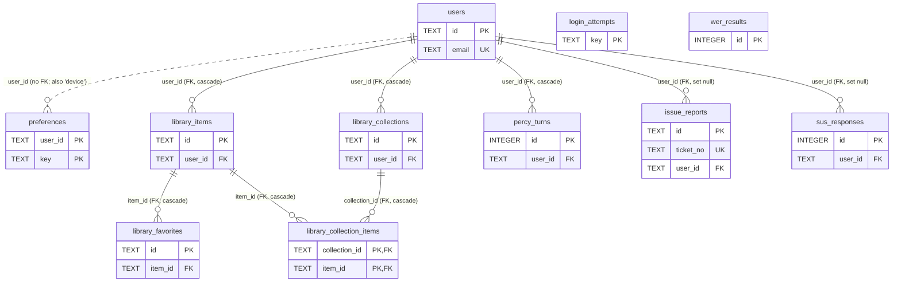
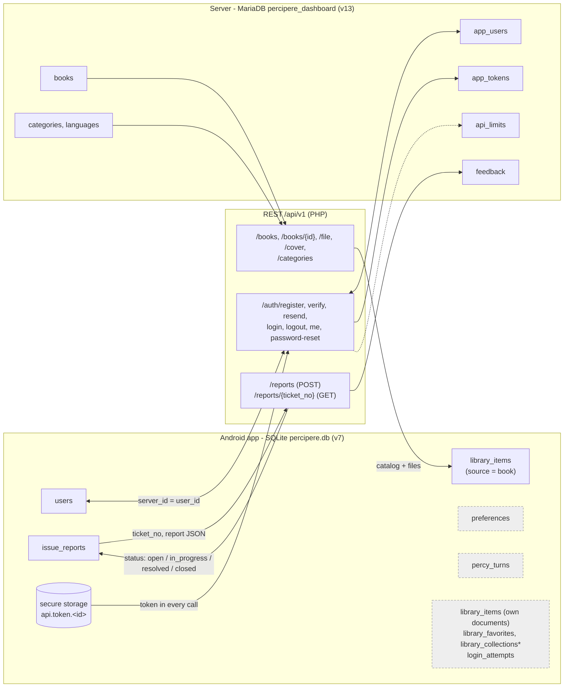

# Percipere - Database Masterlist (v2)

_Generated 2026-10-17 by a **read-only** analysis of the live MySQL database, the dashboard code (branch `feat/admin-roles`, schema v13) and the Android app code (schema v7). Nothing in either codebase or database was changed. Supersedes `database-masterlist.md` (2026-10-13, schema v12)._

Contents: 1 Overview - 2 Server tables - 3 Android tables - 4 REST API and tables - 5 Data dictionary - 6 ERDs - 7 Data flow and privacy - 8 Changes since the last masterlist - 9 Findings - 10 Method.

## 1. Overview

|  | Server database | Android database |
|---|---|---|
| Engine | MariaDB 10.4.32 (XAMPP), InnoDB, utf8mb4_unicode_ci | SQLite via `sqflite`, file `percipere.db` |
| Name / location | `percipere_dashboard` on the dashboard host (PHP, `percipere_web/percipere_dashboard`) | On each phone/tablet (app `percipere_app`) |
| Schema version | **13** (`app_settings.schema_version`; automatic upgrades in `includes/schema.php`) | **v7** (`PRAGMA user_version`; `lib/core/db/migrations.dart`, v1-v7) |
| Tables | 14 (10 foreign keys in the live DB) | 14 (9 in use, 2 reserved/unused, 3 deprecated); 9 foreign keys |
| What it stores | App user accounts and sign-in tokens, reports/feedback and staff notes, the admin-managed book catalog, dashboard staff accounts, roles, audit logs, system settings | Local accounts (incl. guests), settings, the Library (own documents + downloaded books, progress, favorites, collections), Percy turn log, issue reports waiting to be sent |
| Who writes it | The dashboard (admins) and the REST API (the app) | The app only |

**How they connect.** The app **never touches MySQL directly**. The two databases are separate and use different key types (server `INT`, app `TEXT` UUID). They meet only through the REST API `/api/v1` (section 4): accounts (`/auth/*`), the book catalog (`/books`, `/categories`), and reports (`/reports`). Links are carried in values, not constraints (section 6.3).

**Also holding data (not databases):** Android secure storage (Keystore) for the session and sign-in token; the `preferences` table for settings (no SharedPreferences are used); files on the device (`books/`, `texts/`, `covers/` under app support) and on the server (`storage/books/`, `storage/covers/`). See section 7.

### 1.1 Summary of all tables

| DB | Table | Module | Cols | Rows (server) | Status | Purpose |
|---|---|---|---|---|---|---|
| Server | `members` | Team & Staff | 13 | 4 | in use | The project team members. |
| Server | `roles` | Team & Staff | 3 | 3 | in use | The three dashboard roles. |
| Server | `admins` | Team & Staff | 14 | 5 | in use | Dashboard accounts (staff). |
| Server | `admin_audit` | Team & Staff | 10 | 2 | in use | History of changes to dashboard accounts: registration, approval, rejection, role change, (de)activation, creation, deletion. |
| Server | `app_users` | App Users & Auth | 14 | 1 | in use | People who use the Android app (not dashboard staff). |
| Server | `app_tokens` | App Users & Auth | 7 | 0 | in use | One sign-in token per device for the app API. |
| Server | `api_limits` | App Users & Auth | 4 | 1 | in use | Rate-limit and lockout counters (login, registration, reports, dashboard registration). |
| Server | `feedback` | Feedback & Reports | 27 | 0 | in use | Concerns and bug reports. |
| Server | `feedback_notes` | Feedback & Reports | 7 | 0 | in use | Internal notes written by staff on a concern. |
| Server | `audit_log` | Audit & Settings | 5 | 19 | in use | Everything staff do in the dashboard, one sentence per row ("Logged in.", "Updated app user #3."). |
| Server | `app_settings` | Audit & Settings | 4 | 1 | in use | System-wide key/value settings (Settings -> System) and the schema version. |
| Server | `categories` | Library Catalog | 5 | 1 | in use | Book categories created by admins (also from the Add book form). |
| Server | `languages` | Library Catalog | 6 | 2 | in use | Book languages (Filipino and English are seeded). |
| Server | `books` | Library Catalog | 18 | 1 | in use | The admin-managed book catalog the app downloads from (Aklatan). |
| Android | `users` | Accounts | 20 | - | in use | Local accounts on the device: registered users and guests. |
| Android | `preferences` | Settings | 4 | - | in use | Key/value settings per account, plus the device scope for settings made before any account exists. |
| Android | `login_attempts` | Accounts | 4 | - | in use | Failed sign-ins per email, so the lockout survives an app restart. |
| Android | `library_items` | Library (Aklatan) | 35 | - | in use | One row per thing on the user's shelves: own documents (camera, upload, description of an image) and admin books (one row per user per catalog book, so progress and "new" are per user). |
| Android | `library_favorites` | Library (Aklatan) | 8 | - | in use | Saved spots inside an item (a sentence the user marked). |
| Android | `library_collections` | Library (Aklatan) | 6 | - | in use | The user's own named groups of items. |
| Android | `library_collection_items` | Library (Aklatan) | 4 | - | in use | Join table: which items are in which collection. |
| Android | `percy_turns` | Percy (voice assistant) | 9 | - | in use | One row per sentence said to Percy, kept on the phone to retrain the intent classifier. |
| Android | `issue_reports` | Reports | 18 | - | in use | "Mag-report ng problema": every report is saved here first, then sent to the web app. |
| Android | `sus_responses` | Telemetry & Evaluation | 7 | - | unused | System Usability Scale answers (ten answers 1-5 and the score). |
| Android | `wer_results` | Telemetry & Evaluation | 12 | - | unused | Word Error Rate runs (speech recognition accuracy). |
| Android | `usage_logs` | Telemetry & Evaluation | 8 | - | deprecated | Planned anonymous usage events (no user id). |
| Android | `outbox` | Sync | 9 | - | deprecated | Planned offline queue for everything sent to the web app. |
| Android | `documents_legacy` | Library (legacy) | 11 | - | deprecated | Old Reading History, renamed in schema v4 and kept only as a safety copy after its rows were copied into library_items. |

## 2. Server database (MariaDB `percipere_dashboard`, schema 13)

Live data was read **structure-only plus `COUNT(*)`**. Row counts are from 2026-10-17 (the local XAMPP database after manual testing; production may differ). Foreign keys in the live DB: 10, listed in section 6. Passwords/hashes, tokens and emails exist only as column definitions here.

### `members`

- **Module:** Team & Staff
- **Purpose:** The project team members. Kept so audit entries, concern notes and staff accounts can show a team-member display name. The Team tab that edited it was removed in v13; the table is not dropped.
- **Rows (count only):** 4
- **Engine / collation:** InnoDB, utf8mb4_unicode_ci
- **Relationships:** 1 member : 0..1 admin (admins.admin_member_id, FK SET NULL); referenced by audit_log, feedback, feedback_notes
- **Read / written by:**
  - Read (JOIN for names): includes/auth.php, index.php, reports.php, feedback_bugs.php, api/concern_notes.php, api/export_audit.php, includes/staff_accounts.php, settings.php
  - Written: only by the install seed (database.sql) - no page writes it since the Team tab was removed (v13 branch)
- **Indexes:** `email` (member_email)

| Column | Type | Null? | Default | Key | Description | Example (made up) |
|---|---|---|---|---|---|---|
| `member_id` | `int(10) unsigned` | N | `AUTO_INCREMENT` | PK | Team member number. | `2` |
| `member_name` | `varchar(150)` | N |  |  | Display name shown in audit entries and notes. | `Juan Dela Cruz` |
| `member_role` | `varchar(150)` | N |  |  | Project role of the member (free text). | `Developer` |
| `member_school` | `varchar(200)` | N | `''` |  | School / course (free text, v12). | `BS Computer Science` |
| `member_email` | `varchar(191)` | N |  | UNIQUE | Team email, unique. Used to link a staff account when seeded. | `member@example.com` |
| `member_bio` | `varchar(400)` | N | `''` |  | LEGACY personal text, no longer used by the dashboard (candidate for removal, v12_remove_personal_columns.sql). | (empty) |
| `member_photo` | `varchar(255)` | N | `''` |  | LEGACY photo file name, unused. | (empty) |
| `member_age` | `varchar(20)` | N | `''` |  | LEGACY personal field, unused. | (empty) |
| `member_sex` | `varchar(50)` | N | `''` |  | LEGACY personal field, unused. | (empty) |
| `member_address` | `varchar(255)` | N | `''` |  | LEGACY personal field, unused. | (empty) |
| `member_experiences` | `text` | Y | `NULL` |  | LEGACY profile text, unused. | `NULL` |
| `member_contribution` | `text` | Y | `NULL` |  | LEGACY profile text, unused. | `NULL` |
| `member_created_at` | `timestamp` | N | `current_timestamp()` |  | When the row was created. | `2026-10-01 09:00:00` |

### `roles`

- **Module:** Team & Staff
- **Purpose:** The three dashboard roles. Which pages each role may open is NOT stored here: it lives in includes/permissions.php.
- **Rows (count only):** 3
- **Engine / collation:** InnoDB, utf8mb4_unicode_ci
- **Relationships:** 1 role : many admins (admins.admin_role_id - no FK constraint, see findings)
- **Read / written by:**
  - Read: includes/auth.php (role name of the signed-in admin), includes/staff_accounts.php, login.php, settings.php, views/settings/admin.php, api/search.php
  - Written: install seed / migration only
- **Indexes:** `role_name` (role_name)

| Column | Type | Null? | Default | Key | Description | Example (made up) |
|---|---|---|---|---|---|---|
| `role_id` | `int(10) unsigned` | N | `AUTO_INCREMENT` | PK | Role number. | `1` |
| `role_name` | `varchar(50)` | N |  | UNIQUE | Role code used in the code base. | `support_staff` |
| `role_description` | `varchar(255)` | Y | `NULL` |  | Short human description of the role. | `Can manage app users and respond to feedback/bugs` |

### `admins`

- **Module:** Team & Staff
- **Purpose:** Dashboard accounts (staff). A registration request is a row with status pending and no role; a Super Admin approves it and picks a role.
- **Rows (count only):** 5
- **Engine / collation:** InnoDB, utf8mb4_unicode_ci
- **Relationships:** many admins : 1 role (admin_role_id); 0..1 member (admin_member_id, FK SET NULL); referenced by books, feedback, feedback_notes, audit_log, admin_audit, app_settings (mostly without FK constraint)
- **Read / written by:**
  - Read/Write: login.php (failed attempts, lock, last login), register.php (creates pending row), includes/auth.php (every request), settings.php (profile, password, preferences, sign-out-others), includes/staff_accounts.php + api/staff.php (Admin Access)
  - Read: includes/books.php (book_admin_id), api/search.php, index.php, reports.php, feedback_bugs.php (names)
- **Indexes:** `email` (admin_email); `fk_admins_member` (admin_member_id)

| Column | Type | Null? | Default | Key | Description | Example (made up) |
|---|---|---|---|---|---|---|
| `admin_id` | `int(10) unsigned` | N | `AUTO_INCREMENT` | PK | Dashboard account number. | `3` |
| `admin_email` | `varchar(191)` | N |  | UNIQUE | Login email, unique. | `staff@example.com` |
| `admin_full_name` | `varchar(150)` | N | `''` |  | Name shown in the dashboard. | `Staff Example` |
| `admin_password_hash` | `varchar(255)` | N |  |  | Password, stored only as a PHP password_hash (bcrypt) hash. | (bcrypt hash) |
| `admin_member_id` | `int(10) unsigned` | Y | `NULL` | FK -> members.member_id (ON DELETE SET NULL); INDEX | Optional link to a team member (for display names). | `NULL` |
| `admin_role_id` | `int(10) unsigned` | Y | `NULL` |  | Role of the account; NULL while pending/rejected. No FK constraint (see findings). | `2` |
| `admin_status` | `enum('active','suspended','pending','rejected')` | N | `'pending'` |  | Account state: pending, active, suspended (shown as "Deactivated"), rejected. | `active` |
| `admin_failed_login_attempts` | `int(11)` | N | `0` |  | Wrong passwords in a row; 5 locks the account for 15 minutes. | `0` |
| `admin_locked_until` | `datetime` | Y | `NULL` |  | Lock end time after too many wrong passwords. | `NULL` |
| `admin_last_login_at` | `datetime` | Y | `NULL` |  | Last successful sign-in. | `2026-10-17 08:30:00` |
| `admin_preferences` | `text` | Y | `NULL` |  | Personal Settings -> Preferences as JSON (landing page, rows per page, ...). | `{"rows_per_page":10}` |
| `admin_session_version` | `int(10) unsigned` | N | `1` |  | Raised by "Sign out other devices" / password change; older browser sessions are signed out. | `1` |
| `admin_created_at` | `timestamp` | N | `current_timestamp()` |  | Created, or the date the registration request was sent. | `2026-10-17 08:00:00` |
| `admin_updated_at` | `timestamp` | N | `current_timestamp()` |  | Last change (automatic). | `2026-10-17 08:30:00` |

### `admin_audit`

- **Module:** Team & Staff
- **Purpose:** History of changes to dashboard accounts: registration, approval, rejection, role change, (de)activation, creation, deletion. Names and emails are copied in so the history survives a deleted account. New in v13.
- **Rows (count only):** 2
- **Engine / collation:** InnoDB, utf8mb4_unicode_ci
- **Relationships:** audit_actor_admin_id and audit_target_admin_id point to admins.admin_id but have no FK constraint on purpose (history must outlive accounts)
- **Read / written by:**
  - Written: includes/staff_accounts.php (admin_audit_write), register.php
  - Read: settings.php -> Admin Access tab ("Admin access history")
- **Indexes:** `idx_admin_audit_created` (audit_created_at)

| Column | Type | Null? | Default | Key | Description | Example (made up) |
|---|---|---|---|---|---|---|
| `audit_id` | `int(10) unsigned` | N | `AUTO_INCREMENT` | PK | History row number. | `12` |
| `audit_actor_admin_id` | `int(10) unsigned` | Y | `NULL` |  | Admin who did it (NULL for a self-registration). | `1` |
| `audit_actor_name` | `varchar(150)` | N | `''` |  | Copy of the actor name at that time. | `Staff Example` |
| `audit_target_admin_id` | `int(10) unsigned` | Y | `NULL` |  | Account that was changed. | `5` |
| `audit_target_name` | `varchar(150)` | N | `''` |  | Copy of that account name. | `Other Example` |
| `audit_target_email` | `varchar(191)` | N | `''` |  | Copy of that account email. | `other@example.com` |
| `audit_action` | `varchar(30)` | N |  |  | What happened: registered, approved, rejected, role_changed, deactivated, reactivated, created, deleted, migrated. | `approved` |
| `audit_old_value` | `varchar(100)` | Y | `NULL` |  | Previous role (role_changed, deactivated). | `analyst` |
| `audit_new_value` | `varchar(100)` | Y | `NULL` |  | New role (approved, role_changed, created, migrated). | `support_staff` |
| `audit_created_at` | `timestamp` | N | `current_timestamp()` | INDEX | When it happened. | `2026-10-17 09:10:00` |

### `app_users`

- **Module:** App Users & Auth
- **Purpose:** People who use the Android app (not dashboard staff). Created by POST /api/v1/auth/register or by an admin on the Users page.
- **Rows (count only):** 1
- **Engine / collation:** InnoDB, utf8mb4_unicode_ci
- **Relationships:** 1 user : many app_tokens (CASCADE); 1 user : many feedback (feedback_user_id, SET NULL)
- **Read / written by:**
  - Read/Write: api/v1/* via includes/api.php (register, verify, resend, login, me, password reset)
  - Read/Write: users.php + includes/app_users.php (add, edit, suspend, delete), settings.php (approve pending sign-ups)
  - Read: index.php (counts), api/search.php, feedback_bugs.php (reporter)
- **Indexes:** `user_email` (user_email)

| Column | Type | Null? | Default | Key | Description | Example (made up) |
|---|---|---|---|---|---|---|
| `user_id` | `int(10) unsigned` | N | `AUTO_INCREMENT` | PK | App account number; the app stores it as users.server_id. | `17` |
| `user_full_name` | `varchar(100)` | N |  |  | Name given at registration. | `Maria Clara` |
| `user_email` | `varchar(150)` | N |  | UNIQUE | Login email, unique. | `user@example.com` |
| `user_phone_number` | `varchar(20)` | Y | `NULL` |  | Optional phone number (digits). | `09171234567` |
| `user_password_hash` | `varchar(255)` | N |  |  | Password, stored only as a password_hash (bcrypt) hash. | (bcrypt hash) |
| `user_status` | `enum('pending_verification','pending_approval','active','suspended')` | N | `'active'` |  | pending_verification (email code not entered), pending_approval, active, suspended. | `active` |
| `user_email_verified_at` | `datetime` | Y | `NULL` |  | When the emailed 6-digit code was confirmed. | `2026-10-12 10:00:00` |
| `user_otp_hash` | `varchar(255)` | Y | `NULL` |  | Hash of the current emailed code (the code itself is never stored). | (hash) |
| `user_otp_expires_at` | `datetime` | Y | `NULL` |  | Code expiry (10 minutes). | `2026-10-12 10:10:00` |
| `user_otp_sent_at` | `datetime` | Y | `NULL` |  | When the last code was sent (resend delay). | `2026-10-12 10:00:00` |
| `user_position` | `varchar(100)` | Y | `NULL` |  | Position assigned by an admin when approving a sign-up. | `Student` |
| `user_phone_verified_at` | `datetime` | Y | `NULL` |  | Reserved for phone verification; not used by any code. | `NULL` |
| `user_created_at` | `datetime` | N | `current_timestamp()` |  | Registration time. | `2026-10-12 09:58:00` |
| `user_last_login_at` | `datetime` | Y | `NULL` |  | Last app login. | `2026-10-15 07:20:00` |

### `app_tokens`

- **Module:** App Users & Auth
- **Purpose:** One sign-in token per device for the app API. Only the SHA-256 of the token is stored; the token itself is shown to the app once.
- **Rows (count only):** 0
- **Engine / collation:** InnoDB, utf8mb4_unicode_ci
- **Relationships:** many tokens : 1 app_users (FK CASCADE)
- **Read / written by:**
  - Written: includes/api.php (created at login, last_used/expiry refreshed on each call)
  - Deleted: api/v1/logout.php, api/v1/password_reset.php (revokes all)
- **Indexes:** `idx_app_tokens_user` (token_user_id); `token_hash` (token_hash)

| Column | Type | Null? | Default | Key | Description | Example (made up) |
|---|---|---|---|---|---|---|
| `token_id` | `int(10) unsigned` | N | `AUTO_INCREMENT` | PK | Token row number. | `4` |
| `token_user_id` | `int(10) unsigned` | N |  | FK -> app_users.user_id (ON DELETE CASCADE); INDEX | Owner app user. | `17` |
| `token_hash` | `char(64)` | N |  | UNIQUE | SHA-256 of the sign-in token, unique. | (64 hex characters) |
| `token_device` | `varchar(100)` | N | `''` |  | Device label sent by the app. | `Tablet A` |
| `token_created_at` | `datetime` | N | `current_timestamp()` |  | When the token was issued. | `2026-10-12 10:02:00` |
| `token_last_used_at` | `datetime` | N | `current_timestamp()` |  | Last API call with this token. | `2026-10-15 07:20:00` |
| `token_expires_at` | `datetime` | N |  |  | Expiry: 30 days after last use. | `2026-11-14 07:20:00` |

### `api_limits`

- **Module:** App Users & Auth
- **Purpose:** Rate-limit and lockout counters (login, registration, reports, dashboard registration). The key is a SHA-256 so emails and addresses are not readable.
- **Rows (count only):** 1
- **Engine / collation:** InnoDB, utf8mb4_unicode_ci
- **Relationships:** none
- **Read / written by:**
  - Read/Write: includes/api.php (api_limit_hit / locked / reset), includes/staff_accounts.php (register_rate_limited)

| Column | Type | Null? | Default | Key | Description | Example (made up) |
|---|---|---|---|---|---|---|
| `limit_key` | `char(64)` | N |  | PK | SHA-256 of a label such as "login:ip:<address>" or "admin-register:<address>". | (64 hex characters) |
| `limit_count` | `int(10) unsigned` | N | `0` |  | Hits in the current window. | `3` |
| `limit_window_start` | `datetime` | N |  |  | Start of the counting window. | `2026-10-17 08:00:00` |
| `limit_locked_until` | `datetime` | Y | `NULL` |  | End of a lockout, when one was set. | `NULL` |

### `feedback`

- **Module:** Feedback & Reports
- **Purpose:** Concerns and bug reports. Filled by the app (POST /api/v1/reports, "Report an issue") and shown on the Feedback & Bugs page. One row per report; the ticket number is shared with the app.
- **Rows (count only):** 0
- **Engine / collation:** InnoDB, utf8mb4_unicode_ci
- **Relationships:** many feedback : 0..1 app_users (feedback_user_id, SET NULL); many : 0..1 members (feedback_member_id, SET NULL); admins via feedback_admin_id (no FK constraint); 1 feedback : many feedback_notes (CASCADE)
- **Read / written by:**
  - Written: includes/api_reports.php + includes/feedback.php (POST /api/v1/reports), api/v1/feedback.php and feedback_submit.php (old public form), api/concern_status.php, concern_archive.php, concern_restore.php
  - Read: feedback_bugs.php, index.php, reports.php, api/live.php, api/search.php, api/export_concerns.php, api/concern_notes.php, includes/gemini.php (AI summary/query), GET /api/v1/reports/{ticket_no}
- **Indexes:** `fk_feedback_member` (feedback_member_id); `fk_feedback_user` (feedback_user_id); `idx_feedback_archived_at` (feedback_archived_at); `uq_feedback_ticket_no` (feedback_ticket_no)

| Column | Type | Null? | Default | Key | Description | Example (made up) |
|---|---|---|---|---|---|---|
| `feedback_id` | `int(10) unsigned` | N | `AUTO_INCREMENT` | PK | Report number. | `41` |
| `feedback_category` | `varchar(60)` | N | `'General Feedback'` |  | Report type as the app labelled it (Bug, Feature Request, General Feedback). | `Bug` |
| `feedback_type_code` | `varchar(40)` | Y | `NULL` |  | The app code for the type: bug, feature, feedback. | `bug` |
| `feedback_module` | `varchar(60)` | N |  |  | Part of the app the report is about, as labelled by the app (filters come from these values). | `Text-to-Speech` |
| `feedback_module_code` | `varchar(40)` | Y | `NULL` |  | App code for the module (ocr, camera, voice_commands, accounts, text_to_speech, gestures, library, maglarawan, percy, other). | `text_to_speech` |
| `feedback_severity` | `varchar(40)` | N | `''` |  | Severity label; empty when the app sent none (not a bug). | `High` |
| `feedback_severity_code` | `varchar(40)` | Y | `NULL` |  | App code: low, medium, high, critical. | `high` |
| `feedback_description` | `text` | N |  |  | What the user wrote (never document text, pictures or recordings). | `The voice stops after one page.` |
| `feedback_email` | `varchar(191)` | N | `''` |  | Reply email the user typed (optional). | `user@example.com` |
| `feedback_user_id` | `int(10) unsigned` | Y | `NULL` | FK -> app_users.user_id (ON DELETE SET NULL); INDEX | Signed-in app user who sent it; NULL for guests. | `17` |
| `feedback_app_version` | `varchar(20)` | N | `''` |  | App version. | `1.0.0+7` |
| `feedback_device` | `varchar(100)` | N | `''` |  | Device model. | `Galaxy Tab A8` |
| `feedback_os_version` | `varchar(40)` | N | `''` |  | Android version. | `Android 14` |
| `feedback_ticket_no` | `varchar(20)` | Y | `NULL` | UNIQUE | Ticket number made by the app, unique; the app polls status with it. | `PRC-20261012-AB3K` |
| `feedback_source_screen` | `varchar(50)` | N | `''` |  | App screen the report was opened from. | `reader` |
| `feedback_reporter_kind` | `enum('account','guest')` | Y | `NULL` |  | account or guest. | `account` |
| `feedback_reporter_name` | `varchar(100)` | Y | `NULL` |  | Display name the app sent (NULL for guests). | `Maria Clara` |
| `feedback_app_created_at` | `datetime` | Y | `NULL` |  | When the app wrote the report (it may arrive later, offline). | `2026-10-12 10:05:00` |
| `feedback_status` | `enum('Open','In Progress','Resolved')` | N | `'Open'` |  | Open, In Progress or Resolved (archived is a separate column). | `Open` |
| `feedback_source` | `enum('app','seed')` | N | `'app'` |  | app (real report) or seed (sample row). | `app` |
| `feedback_submitted_at` | `date` | N |  |  | Date submitted. | `2026-10-12` |
| `feedback_resolved_at` | `date` | Y | `NULL` |  | Date resolved. | `NULL` |
| `feedback_archived_at` | `datetime` | Y | `NULL` | INDEX | When a staff member archived it (the app then sees "closed"). | `NULL` |
| `feedback_member_id` | `int(10) unsigned` | Y | `NULL` | FK -> members.member_id (ON DELETE SET NULL); INDEX | Team member who last changed it (legacy attribution). | `NULL` |
| `feedback_admin_id` | `int(10) unsigned` | Y | `NULL` |  | Staff account that last changed it. No FK constraint. | `2` |
| `feedback_created_at` | `timestamp` | N | `current_timestamp()` |  | When the server received it. | `2026-10-12 10:05:03` |
| `feedback_updated_at` | `timestamp` | N | `current_timestamp()` |  | Last change (automatic). | `2026-10-13 09:00:00` |

### `feedback_notes`

- **Module:** Feedback & Reports
- **Purpose:** Internal notes written by staff on a concern. Never sent to the app.
- **Rows (count only):** 0
- **Engine / collation:** InnoDB, utf8mb4_unicode_ci
- **Relationships:** many notes : 1 feedback (CASCADE); many : 0..1 members (note_member_id, CASCADE - see findings); admins via note_admin_id (no FK constraint)
- **Read / written by:**
  - Read/Write: api/concern_notes.php (Feedback & Bugs detail panel)
- **Indexes:** `fk_feedback_notes_feedback` (note_feedback_id); `fk_feedback_notes_member` (note_member_id)

| Column | Type | Null? | Default | Key | Description | Example (made up) |
|---|---|---|---|---|---|---|
| `note_id` | `int(10) unsigned` | N | `AUTO_INCREMENT` | PK | Note number. | `8` |
| `note_feedback_id` | `int(10) unsigned` | N |  | FK -> feedback.feedback_id (ON DELETE CASCADE); INDEX | Report the note belongs to. | `41` |
| `note_member_id` | `int(10) unsigned` | Y | `NULL` | FK -> members.member_id (ON DELETE CASCADE); INDEX | Team member who wrote it (legacy). | `NULL` |
| `note_admin_id` | `int(10) unsigned` | Y | `NULL` |  | Staff account who wrote it. No FK constraint. | `2` |
| `note_text` | `text` | N |  |  | Note text (up to 2,000 characters). | `Reproduced on the tablet.` |
| `note_created_at` | `timestamp` | N | `current_timestamp()` |  | When written. | `2026-10-13 09:00:00` |
| `note_updated_at` | `timestamp` | N | `current_timestamp()` |  | Last edit (automatic). | `2026-10-13 09:05:00` |

### `audit_log`

- **Module:** Audit & Settings
- **Purpose:** Everything staff do in the dashboard, one sentence per row ("Logged in.", "Updated app user #3."). Shown on Reports -> Audit Log (Super Admin only).
- **Rows (count only):** 19
- **Engine / collation:** InnoDB, utf8mb4_unicode_ci
- **Relationships:** many log rows : 0..1 members (log_member_id, FK CASCADE - see findings); admins via log_admin_id (no FK constraint)
- **Read / written by:**
  - Written: includes/audit.php (log_admin_action) from login, logout, settings, users, library, api/concern_*, api/staff.php
  - Read: reports.php, index.php (Recent activity), api/export_audit.php, api/concern_notes.php (concern history), settings.php (login history)
- **Indexes:** `fk_audit_member` (log_member_id)

| Column | Type | Null? | Default | Key | Description | Example (made up) |
|---|---|---|---|---|---|---|
| `log_id` | `int(10) unsigned` | N | `AUTO_INCREMENT` | PK | Log row number. | `230` |
| `log_member_id` | `int(10) unsigned` | Y | `NULL` | FK -> members.member_id (ON DELETE CASCADE); INDEX | Team member behind the action (when the account is linked). FK CASCADE. | `NULL` |
| `log_admin_id` | `int(10) unsigned` | Y | `NULL` |  | Staff account that did it. No FK constraint. | `2` |
| `log_action` | `varchar(255)` | N |  |  | One sentence describing the action. | `Updated app user #3.` |
| `log_created_at` | `timestamp` | N | `current_timestamp()` |  | When it happened. | `2026-10-17 08:31:00` |

### `app_settings`

- **Module:** Audit & Settings
- **Purpose:** System-wide key/value settings (Settings -> System) and the schema version. Missing keys fall back to defaults in includes/app_settings.php.
- **Rows (count only):** 1
- **Engine / collation:** InnoDB, utf8mb4_unicode_ci
- **Relationships:** setting_admin_id -> admins.admin_id (no FK constraint)
- **Read / written by:**
  - Read: includes/app_settings.php, includes/api.php (app_registration_approval)
  - Written: settings.php (System tab), includes/schema.php (schema_version)

| Column | Type | Null? | Default | Key | Description | Example (made up) |
|---|---|---|---|---|---|---|
| `setting_key` | `varchar(64)` | N |  | PK | Setting name: high_priority_alert_days, anomaly_threshold_pct, support_email, live_poll_seconds, app_registration_approval, schema_version. | `live_poll_seconds` |
| `setting_value` | `varchar(255)` | N |  |  | Value as text. | `45` |
| `setting_updated_at` | `timestamp` | N | `current_timestamp()` |  | Last change (automatic). | `2026-10-17 08:00:00` |
| `setting_admin_id` | `int(10) unsigned` | Y | `NULL` |  | Admin who last saved it. No FK constraint. | `1` |

### `categories`

- **Module:** Library Catalog
- **Purpose:** Book categories created by admins (also from the Add book form). A hidden category is not offered in the app.
- **Rows (count only):** 1
- **Engine / collation:** InnoDB, utf8mb4_unicode_ci
- **Relationships:** 1 category : many books (FK RESTRICT)
- **Read / written by:**
  - Read/Write: library.php, library_book.php, includes/books.php, api/categories.php (admin JSON)
  - Read: GET /api/v1/categories and /api/v1/books via includes/api_books.php
- **Indexes:** `uq_categories_name` (category_name)

| Column | Type | Null? | Default | Key | Description | Example (made up) |
|---|---|---|---|---|---|---|
| `category_id` | `int(10) unsigned` | N | `AUTO_INCREMENT` | PK | Category number. | `3` |
| `category_name` | `varchar(80)` | N |  | UNIQUE | Category name, unique. | `Kuwentong Pambata` |
| `category_is_active` | `tinyint(1)` | N | `1` |  | 1 = offered; 0 = hidden. | `1` |
| `category_created_at` | `timestamp` | N | `current_timestamp()` |  | Created. | `2026-10-11 10:00:00` |
| `category_updated_at` | `timestamp` | N | `current_timestamp()` |  | Last change (automatic). | `2026-10-11 10:00:00` |

### `languages`

- **Module:** Library Catalog
- **Purpose:** Book languages (Filipino and English are seeded). The code lets the app pick the reading voice.
- **Rows (count only):** 2
- **Engine / collation:** InnoDB, utf8mb4_unicode_ci
- **Relationships:** 1 language : many books (FK RESTRICT)
- **Read / written by:**
  - Read/Write: library.php, library_book.php, includes/books.php
  - Read: includes/api_books.php (book language in the catalog)
- **Indexes:** `uq_languages_name` (language_name)

| Column | Type | Null? | Default | Key | Description | Example (made up) |
|---|---|---|---|---|---|---|
| `language_id` | `int(10) unsigned` | N | `AUTO_INCREMENT` | PK | Language number. | `1` |
| `language_name` | `varchar(40)` | N |  | UNIQUE | Language name, unique. | `Filipino` |
| `language_code` | `varchar(10)` | Y | `NULL` |  | Short code that picks the reading voice. | `fil` |
| `language_is_active` | `tinyint(1)` | N | `1` |  | 1 = offered; 0 = hidden. | `1` |
| `language_created_at` | `timestamp` | N | `current_timestamp()` |  | Created. | `2026-10-11 10:00:00` |
| `language_updated_at` | `timestamp` | N | `current_timestamp()` |  | Last change (automatic). | `2026-10-11 10:00:00` |

### `books`

- **Module:** Library Catalog
- **Purpose:** The admin-managed book catalog the app downloads from (Aklatan). The files themselves are on disk in storage/books and storage/covers, not in the database.
- **Rows (count only):** 1
- **Engine / collation:** InnoDB, utf8mb4_unicode_ci
- **Relationships:** many books : 1 category (RESTRICT); many books : 1 language (RESTRICT); many books : 0..1 admins (book_admin_id, SET NULL)
- **Read / written by:**
  - Read/Write: library.php, library_book.php, includes/books.php, api/book.php (edit pop-up), library_file.php (streams file/cover to admins)
  - Read: GET /api/v1/books, /books/{id}, /books/{id}/file, /books/{id}/cover (includes/api_books.php); includes/app_versions.php
- **Indexes:** `fk_books_admin` (book_admin_id); `idx_books_active_updated` (book_is_active, book_updated_at); `idx_books_category` (book_category_id); `idx_books_language` (book_language_id)

| Column | Type | Null? | Default | Key | Description | Example (made up) |
|---|---|---|---|---|---|---|
| `book_id` | `int(10) unsigned` | N | `AUTO_INCREMENT` | PK | Book number; the app stores it as library_items.book_id. | `5` |
| `book_title` | `varchar(200)` | N |  |  | Title. | `Ang Alamat ng Pinya` |
| `book_author` | `varchar(150)` | N | `''` |  | Author (may be empty). | `Hindi Kilala` |
| `book_description` | `text` | Y | `NULL` |  | Short description. | `Isang alamat.` |
| `book_category_id` | `int(10) unsigned` | N |  | FK -> categories.category_id (ON DELETE RESTRICT); INDEX | Category. | `3` |
| `book_language_id` | `int(10) unsigned` | N |  | FK -> languages.language_id (ON DELETE RESTRICT); INDEX | Language. | `1` |
| `book_format` | `enum('pdf','epub')` | N |  |  | pdf or epub. | `epub` |
| `book_file_path` | `varchar(80)` | N |  |  | Random file name inside storage/books/ (not guessable). | `a1b2c3d4.epub` |
| `book_file_name` | `varchar(255)` | N |  |  | Original upload name, for display only. | `alamat-ng-pinya.epub` |
| `book_file_size` | `int(10) unsigned` | N |  |  | File size in bytes. | `482113` |
| `book_file_hash` | `char(64)` | N |  |  | SHA-256 of the file; the app checks its copy with it. | (64 hex characters) |
| `book_cover_path` | `varchar(80)` | Y | `NULL` |  | Random cover file name inside storage/covers/. | `e5f6.jpg` |
| `book_cover_mime` | `varchar(20)` | Y | `NULL` |  | Cover MIME type. | `image/jpeg` |
| `book_is_active` | `tinyint(1)` | N | `1` | INDEX | 1 = shown to the app; 0 = hidden (books are never deleted by accident). | `1` |
| `book_version` | `int(10) unsigned` | N | `1` |  | Raised whenever the file or details change; the app compares it with its copy. | `2` |
| `book_admin_id` | `int(10) unsigned` | Y | `NULL` | FK -> admins.admin_id (ON DELETE SET NULL); INDEX | Admin who last saved it. | `1` |
| `book_created_at` | `timestamp` | N | `current_timestamp()` |  | Created. | `2026-10-11 10:30:00` |
| `book_updated_at` | `timestamp` | N | `current_timestamp()` |  | Last change; GET /books?updated_since uses it. | `2026-10-12 09:00:00` |

## 3. Android database (SQLite `percipere.db`, schema v7)

Built by running the real migrations v1-v7 from `lib/core/db/migrations.dart` in SQLite and reading `PRAGMA table_info / index_list / foreign_key_list`, so it is the exact final schema. Timestamps are INTEGER milliseconds since 1970 (UTC); JSON is stored as TEXT; `PRAGMA foreign_keys = ON` at open.

Migration history: v1 Initial schema; v2 Email + password accounts (Phase 6B); v3 Image descriptions in history (Phase 6C); v4 Library replaces Reading History (Phase 6E); v5 Percy turn log for retraining (Phase 9); v6 Issue reports (Phase 10); v7 Report status from the web app.

### `users`

- **Module:** Accounts
- **Status:** in use
- **Purpose:** Local accounts on the device: registered users and guests. The password / PIN is stored only as a salted hash. A signed-in account also has a server_id (its app_users.user_id).
- **Counterpart on the server:** app_users (server_id = app_users.user_id; created through POST /api/v1/auth/register, login via /auth/login)
- **Relationships:** 1 user : many preferences, library_items, library_collections, percy_turns (CASCADE); sus_responses and issue_reports (SET NULL)
- **Read / written by:**
  - lib/core/auth/account_repository.dart (all reads/writes); screens: Welcome, Register, Login, Forgot password, Profiling (setup), Settings -> Account
- **Indexes:** `idx_users_email` (email)

| Column | Type | Null? | Default | Key | Description | Example (made up) |
|---|---|---|---|---|---|---|
| `id` | `TEXT` | N |  | PK; UNIQUE | Account id generated on the device (UUID). | `3f2b9c1e-7a54-4d1b-9a2e-5b6c7d8e9f01` |
| `display_name` | `TEXT` | N |  |  | Name shown in the app. | `Maria` |
| `email` | `TEXT` | Y |  | UNIQUE | Email = the username; unique, case-insensitive; NULL for guests and old PIN accounts. | `user@example.com` |
| `secret_hash` | `TEXT` | N |  |  | Hash of the password (or legacy PIN). Never the password itself. | (hash) |
| `secret_salt` | `TEXT` | N |  |  | Random salt for that hash. | (salt) |
| `remote_id` | `TEXT` | Y |  |  | Old name of server_id (kept; both filled the same way). | `NULL` |
| `created_at` | `INTEGER` | N |  |  | Created (ms since 1970, UTC). | `1760000000000` |
| `updated_at` | `INTEGER` | N |  |  | Last change (ms). | `1760000500000` |
| `last_login_at` | `INTEGER` | Y |  |  | Last login (ms). | `1760100000000` |
| `first_name` | `TEXT` | Y |  |  | First name from registration. | `Maria` |
| `last_name` | `TEXT` | Y |  |  | Last name from registration. | `Clara` |
| `secret_kind` | `TEXT` | N | `'pin'` |  | How the secret was made: pin (legacy), pbkdf2-sha256:<n> (password), none (guest). | `pbkdf2-sha256:120000` |
| `security_question` | `TEXT` | Y |  |  | Id of the chosen security question (forgot password). | `pet_name` |
| `security_answer_hash` | `TEXT` | Y |  |  | Hash of the normalised answer. | (hash) |
| `security_answer_salt` | `TEXT` | Y |  |  | Salt for the answer hash. | (salt) |
| `is_guest` | `INTEGER` | N | `0` |  | 1 = guest account (never synced). | `0` |
| `profiling_completed` | `INTEGER` | N | `0` |  | 1 once the first-run profiling finished. | `1` |
| `fingerprint_enabled` | `INTEGER` | N | `0` |  | 1 = fingerprint login on for this account. | `0` |
| `synced` | `INTEGER` | N | `0` |  | 1 = the web app has this version of the account. | `1` |
| `server_id` | `TEXT` | Y |  |  | The account number on the server (app_users.user_id) as text. | `17` |

### `preferences`

- **Module:** Settings
- **Status:** in use
- **Purpose:** Key/value settings per account, plus the device scope for settings made before any account exists. Values are JSON, so new settings never need a migration. Keys are listed in section 7.
- **Counterpart on the server:** none (stays on the device)
- **Relationships:** user_id is a users.id or the text "device" (no FK constraint)
- **Read / written by:**
  - lib/core/db/daos/preferences_dao.dart (PreferencesDao, used by 11 files: Settings screens, voice, TTS, Reader, Percy, tutorial, setup, bootstrap)

| Column | Type | Null? | Default | Key | Description | Example (made up) |
|---|---|---|---|---|---|---|
| `user_id` | `TEXT` | N |  | PK (composite) | users.id, or "device" for settings made before any account. | `device` |
| `key` | `TEXT` | N |  | PK (composite) | Setting name (see section 7). | `tts.readingRate` |
| `value` | `TEXT` | N |  |  | JSON-encoded value. | `1.0` |
| `updated_at` | `INTEGER` | N |  |  | Last change (ms). | `1760000000000` |

### `login_attempts`

- **Module:** Accounts
- **Status:** in use
- **Purpose:** Failed sign-ins per email, so the lockout survives an app restart. Keys: "login:<email>" or "reset:<email>".
- **Counterpart on the server:** api_limits does the same job on the server (different mechanism)
- **Relationships:** none
- **Read / written by:**
  - lib/core/auth/login_throttle.dart (Login and Forgot-password screens)

| Column | Type | Null? | Default | Key | Description | Example (made up) |
|---|---|---|---|---|---|---|
| `key` | `TEXT` | N |  | PK; UNIQUE | "login:<email>" or "reset:<email>" (lowercase). | `login:user@example.com` |
| `failures` | `INTEGER` | N | `0` |  | Wrong tries in a row. | `2` |
| `locked_until` | `INTEGER` | Y |  |  | Lock end (ms), NULL if not locked. | `NULL` |
| `updated_at` | `INTEGER` | N |  |  | Last failure (ms). | `1760000000000` |

### `library_items`

- **Module:** Library (Aklatan)
- **Status:** in use
- **Purpose:** One row per thing on the user's shelves: own documents (camera, upload, description of an image) and admin books (one row per user per catalog book, so progress and "new" are per user).
- **Counterpart on the server:** books (rows with source = book; library_items.book_id = books.book_id as text). Own documents never leave the device (local_only = 1).
- **Relationships:** many items : 1 users (CASCADE); 1 item : many library_favorites, library_collection_items (CASCADE)
- **Read / written by:**
  - lib/core/db/daos/library_dao.dart; lib/core/library/library_service.dart; screens: Library, Chapters, Favorites, Item details, Reader, Camera/Upload save, Maglarawan (describe)
  - lib/core/auth/account_repository.dart (account delete / guest merge)
  - Admin books: lib/core/library/admin_book_repository.dart (GET /api/v1/books, /books/{id}/file, /cover)
- **Indexes:** `idx_library_items_book` (user_id, book_id); `idx_library_items_user` (user_id, last_opened_at)

| Column | Type | Null? | Default | Key | Description | Example (made up) |
|---|---|---|---|---|---|---|
| `id` | `TEXT` | N |  | PK; UNIQUE | Item id (UUID). | `8c1d...` |
| `user_id` | `TEXT` | Y |  | FK -> users.id (ON DELETE CASCADE); UNIQUE (composite index); INDEX | Owner account. | (users.id) |
| `source` | `TEXT - CHECK source IN ('camera', 'upload', 'description', 'book')` | N |  |  | Where it came from: camera, upload, description, book. | `book` |
| `format` | `TEXT - CHECK format IN ('image', 'pdf', 'docx', 'epub')` | N |  |  | image, pdf, docx or epub. | `epub` |
| `language` | `TEXT` | N | `'fil'` |  | fil or en. | `fil` |
| `title` | `TEXT` | N |  |  | Title. | `Ang Alamat ng Pinya` |
| `author` | `TEXT` | Y |  |  | Author (books). | `Hindi Kilala` |
| `cover_path` | `TEXT` | Y |  |  | Cover image file on the device. | `covers/8c1d.jpg` |
| `file_path` | `TEXT` | Y |  |  | Downloaded book file on the device. | `books/8c1d.epub` |
| `text_ref` | `TEXT` | N | `'db'` |  | Where the text is: db (full_text column) or file (text_path). | `db` |
| `full_text` | `TEXT` | Y |  |  | The text itself when text_ref = db (never leaves the device). | (text) |
| `text_path` | `TEXT` | Y |  |  | Text file on the device when text_ref = file. | `NULL` |
| `chapters` | `TEXT` | Y |  |  | JSON list of chapters. | `[{"title":"Simula"}]` |
| `total_sentences` | `INTEGER` | Y |  |  | Sentence count. | `420` |
| `word_count` | `INTEGER` | Y |  |  | Word count. | `5100` |
| `chapter_index` | `INTEGER` | N | `0` |  | Chapter the user is in. | `2` |
| `sentence_index` | `INTEGER` | N | `0` |  | Sentence the user is at. | `17` |
| `percent` | `REAL` | N | `0` |  | Reading progress, 0-100. | `34.5` |
| `finished` | `INTEGER` | N | `0` |  | 1 = read to the end. | `0` |
| `last_opened_at` | `INTEGER` | Y |  | INDEX | Last opened (ms). | `1760000000000` |
| `created_at` | `INTEGER` | N |  |  | Added (ms). | `1760000000000` |
| `updated_at` | `INTEGER` | N |  |  | Last change (ms). | `1760000000000` |
| `book_id` | `TEXT` | Y |  | UNIQUE (composite index) | Server book number (books.book_id) as TEXT; NULL for own documents. | `5` |
| `book_version` | `INTEGER` | Y |  |  | Version of the downloaded copy. | `2` |
| `remote_version` | `INTEGER` | Y |  |  | Latest version the catalog reported. | `3` |
| `category` | `TEXT` | Y |  |  | Category name from the catalog. | `Kuwentong Pambata` |
| `description` | `TEXT` | Y |  |  | Description from the catalog. | `Isang alamat.` |
| `cover_url` | `TEXT` | Y |  |  | Cover address on the server. | `/api/v1/books/5/cover` |
| `file_size` | `INTEGER` | Y |  |  | Size of the book file in bytes. | `482113` |
| `downloaded` | `INTEGER` | N | `0` |  | 1 = the file is on the device. | `1` |
| `is_new` | `INTEGER` | N | `0` |  | 1 = new in the catalog, not yet opened. | `0` |
| `unavailable` | `INTEGER` | N | `0` |  | 1 = the catalog no longer lists it. | `0` |
| `local_only` | `INTEGER` | N | `0` |  | 1 = never sent to the server (own documents). | `1` |
| `synced` | `INTEGER` | N | `0` |  | Reserved for Phase 7 library sync. | `0` |
| `legacy_id` | `INTEGER` | Y |  |  | Old documents.id this row came from (v4 copy). Unused afterwards. | `12` |

### `library_favorites`

- **Module:** Library (Aklatan)
- **Status:** in use
- **Purpose:** Saved spots inside an item (a sentence the user marked).
- **Counterpart on the server:** none yet (Phase 7 sync designed, not built)
- **Relationships:** many favorites : 1 library_items (CASCADE)
- **Read / written by:**
  - lib/core/db/daos/library_dao.dart; Favorites screen, Reader
- **Indexes:** `idx_library_favorites_item` (item_id)

| Column | Type | Null? | Default | Key | Description | Example (made up) |
|---|---|---|---|---|---|---|
| `id` | `TEXT` | N |  | PK; UNIQUE | Favorite id (UUID). | `1a2b...` |
| `item_id` | `TEXT` | N |  | FK -> library_items.id (ON DELETE CASCADE); INDEX | Item it belongs to. | (library_items.id) |
| `chapter_index` | `INTEGER` | N | `0` |  | Chapter. | `2` |
| `sentence_index` | `INTEGER` | N |  |  | Sentence. | `17` |
| `label` | `TEXT` | N |  |  | Text shown for the favorite. | `Paboritong bahagi` |
| `created_at` | `INTEGER` | N |  |  | Created (ms). | `1760000000000` |
| `updated_at` | `INTEGER` | N |  |  | Changed (ms). | `1760000000000` |
| `synced` | `INTEGER` | N | `0` |  | Reserved for Phase 7. | `0` |

### `library_collections`

- **Module:** Library (Aklatan)
- **Status:** in use
- **Purpose:** The user's own named groups of items.
- **Counterpart on the server:** none yet (Phase 7)
- **Relationships:** many collections : 1 users (CASCADE); 1 collection : many library_collection_items (CASCADE)
- **Read / written by:**
  - lib/core/db/daos/library_dao.dart; Library screen
  - lib/core/auth/account_repository.dart

| Column | Type | Null? | Default | Key | Description | Example (made up) |
|---|---|---|---|---|---|---|
| `id` | `TEXT` | N |  | PK; UNIQUE | Collection id (UUID). | `9d8c...` |
| `user_id` | `TEXT` | Y |  | FK -> users.id (ON DELETE CASCADE) | Owner account. | (users.id) |
| `name` | `TEXT` | N |  |  | Collection name. | `Para sa klase` |
| `created_at` | `INTEGER` | N |  |  | Created (ms). | `1760000000000` |
| `updated_at` | `INTEGER` | N |  |  | Changed (ms). | `1760000000000` |
| `synced` | `INTEGER` | N | `0` |  | Reserved for Phase 7. | `0` |

### `library_collection_items`

- **Module:** Library (Aklatan)
- **Status:** in use
- **Purpose:** Join table: which items are in which collection.
- **Counterpart on the server:** none
- **Relationships:** many-to-many between library_collections and library_items (both CASCADE)
- **Read / written by:**
  - lib/core/db/daos/library_dao.dart

| Column | Type | Null? | Default | Key | Description | Example (made up) |
|---|---|---|---|---|---|---|
| `collection_id` | `TEXT` | N |  | PK (composite); FK -> library_collections.id (ON DELETE CASCADE) | Collection. | (library_collections.id) |
| `item_id` | `TEXT` | N |  | PK (composite); FK -> library_items.id (ON DELETE CASCADE) | Item in it. | (library_items.id) |
| `added_at` | `INTEGER` | N |  |  | When added (ms). | `1760000000000` |
| `synced` | `INTEGER` | N | `0` |  | Reserved for Phase 7. | `0` |

### `percy_turns`

- **Module:** Percy (voice assistant)
- **Status:** in use
- **Purpose:** One row per sentence said to Percy, kept on the phone to retrain the intent classifier. No document content. Logging can be switched off (preference percy.logging).
- **Counterpart on the server:** none (never sent to the server)
- **Relationships:** many turns : 1 users (CASCADE)
- **Read / written by:**
  - lib/core/db/daos/percy_log_dao.dart; lib/core/percy/percy_controller.dart (writes), percy_log_export.dart (export to a file for the team)
- **Indexes:** `idx_percy_turns_user` (user_id, created_at)

| Column | Type | Null? | Default | Key | Description | Example (made up) |
|---|---|---|---|---|---|---|
| `id` | `INTEGER` | N |  | PK | Turn number. | `1` |
| `user_id` | `TEXT` | Y |  | FK -> users.id (ON DELETE CASCADE); INDEX | Who spoke (CASCADE on account delete). | (users.id) |
| `text` | `TEXT` | N |  |  | The sentence said to Percy (no document content). | `basahin mo ang huling dokumento` |
| `intent` | `TEXT` | Y |  |  | Intent the classifier chose. | `read_last_document` |
| `confidence` | `REAL` | Y |  |  | Classifier confidence 0-1. | `0.93` |
| `outcome` | `TEXT` | N |  |  | What happened: acted, confirmed, corrected, declined, asked, fallback, chat, answered, notAvailable, matcher. | `acted` |
| `screen` | `TEXT` | Y |  |  | Screen when it was said. | `home` |
| `model_version` | `TEXT` | Y |  |  | Classifier model version. | `v2` |
| `created_at` | `INTEGER` | N |  | INDEX | When (ms). | `1760000000000` |

### `issue_reports`

- **Module:** Reports
- **Status:** in use
- **Purpose:** "Mag-report ng problema": every report is saved here first, then sent to the web app. A report outlives its writer (user_id becomes NULL), so none is lost. Never contains document text, pictures or recordings.
- **Counterpart on the server:** feedback (POST /api/v1/reports; status via GET /api/v1/reports/{ticket_no}; shared key ticket_no)
- **Relationships:** many reports : 0..1 users (SET NULL)
- **Read / written by:**
  - lib/core/report/issue_report_repository.dart, issue_report_sync.dart, issue_report_api.dart; screens: Report an issue, My reports
  - lib/core/auth/account_repository.dart (account delete)
- **Indexes:** `idx_issue_reports_user` (user_id, created_at); `idx_issue_reports_sync` (sync_status, created_at)

| Column | Type | Null? | Default | Key | Description | Example (made up) |
|---|---|---|---|---|---|---|
| `id` | `TEXT` | N |  | PK; UNIQUE | Report id (UUID). | `5e6f...` |
| `ticket_no` | `TEXT` | N |  | UNIQUE | Ticket number shown to the user, unique. | `PRC-20261012-AB3K` |
| `user_id` | `TEXT` | Y |  | FK -> users.id (ON DELETE SET NULL); INDEX | Writer (NULL if the account was deleted or a guest). | (users.id) |
| `type` | `TEXT` | N |  |  | bug, feature or feedback. | `bug` |
| `module` | `TEXT` | N |  |  | ocr, camera, voice_commands, accounts, text_to_speech, gestures, library, maglarawan, percy, other. | `text_to_speech` |
| `severity` | `TEXT` | Y |  |  | low, medium, high, critical (bugs only). | `high` |
| `description` | `TEXT` | N |  |  | What the user wrote. | `The voice stops after one page.` |
| `email` | `TEXT` | Y |  |  | Optional reply email. | `user@example.com` |
| `app_version` | `TEXT` | N |  |  | App version. | `1.0.0+7` |
| `os_version` | `TEXT` | N |  |  | Android version. | `Android 14` |
| `device_model` | `TEXT` | N |  |  | Device model. | `Galaxy Tab A8` |
| `source_screen` | `TEXT` | N |  |  | Screen the report was opened from. | `reader` |
| `created_at` | `INTEGER` | N |  | INDEX | Written (ms). | `1760000000000` |
| `sync_status` | `TEXT` | N | `'pending'` | INDEX | Sending state: pending, sent, failed. | `sent` |
| `server_id` | `TEXT` | Y |  |  | Server feedback_id once sent. | `41` |
| `attempts` | `INTEGER` | N | `0` |  | Send tries. | `1` |
| `last_error` | `TEXT` | Y |  |  | Last send error. | `NULL` |
| `server_status` | `TEXT` | Y |  |  | What the web app says: open, in_progress, resolved, closed; NULL = not asked yet (v7). | `open` |

### `sus_responses` (unused)

- **Module:** Telemetry & Evaluation
- **Status:** created by migrations, **no code uses it yet**
- **Purpose:** System Usability Scale answers (ten answers 1-5 and the score). Table exists for Phase 7/8 evaluation; no screen or DAO uses it yet.
- **Counterpart on the server:** none (the server has no SUS table)
- **Relationships:** user_id -> users.id (SET NULL)
- **Read / written by:**
  - No app code

| Column | Type | Null? | Default | Key | Description | Example (made up) |
|---|---|---|---|---|---|---|
| `id` | `INTEGER` | N |  | PK | Response number. | `1` |
| `user_id` | `TEXT` | Y |  | FK -> users.id (ON DELETE SET NULL) | Who answered (SET NULL if the account is deleted). | (users.id) |
| `answers` | `TEXT` | N |  |  | JSON array of ten answers, 1-5. | `[4,2,5,1,4,2,5,1,4,2]` |
| `score` | `REAL - CHECK score BETWEEN 0 AND 100` | N |  |  | SUS score 0-100. | `82.5` |
| `language` | `TEXT` | N |  |  | fil or en. | `fil` |
| `input_mode` | `TEXT` | Y |  |  | How the app was used. | `voice` |
| `created_at` | `INTEGER` | N |  |  | When (ms). | `1760000000000` |

### `wer_results` (unused)

- **Module:** Telemetry & Evaluation
- **Status:** created by migrations, **no code uses it yet**
- **Purpose:** Word Error Rate runs (speech recognition accuracy). Table exists for evaluation (Phase 6D/8); no code writes it yet.
- **Counterpart on the server:** none
- **Relationships:** none
- **Read / written by:**
  - No app code
- **Indexes:** `idx_wer_results_session` (session_id)

| Column | Type | Null? | Default | Key | Description | Example (made up) |
|---|---|---|---|---|---|---|
| `id` | `INTEGER` | N |  | PK | Run number. | `1` |
| `session_id` | `TEXT` | N |  | INDEX | Evaluation session. | `b7c1...` |
| `locale` | `TEXT` | N |  |  | Speech language. | `fil-PH` |
| `on_device` | `INTEGER - CHECK on_device IN (0, 1)` | N |  |  | 1 = offline recognition, 0 = online. | `1` |
| `reference` | `TEXT` | N |  |  | What was supposed to be said. | `basahin ang dokumento` |
| `hypothesis` | `TEXT` | N |  |  | What the recogniser heard. | `basahin ang dokumento` |
| `substitutions` | `INTEGER` | N |  |  | Wrong words. | `0` |
| `deletions` | `INTEGER` | N |  |  | Missed words. | `0` |
| `insertions` | `INTEGER` | N |  |  | Extra words. | `0` |
| `reference_words` | `INTEGER` | N |  |  | Words in the reference. | `3` |
| `wer` | `REAL` | N |  |  | Word error rate = (S+D+I) / reference words. | `0.0` |
| `created_at` | `INTEGER` | N |  |  | When (ms). | `1760000000000` |

### `usage_logs` (deprecated)

- **Module:** Telemetry & Evaluation
- **Status:** **deprecated** - no code uses it; kept by migrations
- **Purpose:** Planned anonymous usage events (no user id). Created in v1; no code writes it. A server table for it does not exist.
- **Counterpart on the server:** none (planned outbox type usage_logs)
- **Relationships:** none
- **Read / written by:**
  - No app code
- **Indexes:** `idx_usage_logs_uploaded` (uploaded_at)

| Column | Type | Null? | Default | Key | Description | Example (made up) |
|---|---|---|---|---|---|---|
| `id` | `INTEGER` | N |  | PK | Event number. | `1` |
| `session_id` | `TEXT` | N |  |  | Random per-session id (no user id). | `b7c1...` |
| `event_type` | `TEXT` | N |  |  | Event name. | `screen_open` |
| `screen` | `TEXT` | Y |  |  | Screen id. | `reader` |
| `input_mode` | `TEXT - CHECK input_mode IS NULL OR input_mode IN ('gesture', 'voice', 'touch', 'talkback')` | Y |  |  | gesture, voice, touch or talkback. | `voice` |
| `payload` | `TEXT` | Y |  |  | Extra JSON. | `{}` |
| `created_at` | `INTEGER` | N |  |  | When (ms). | `1760000000000` |
| `uploaded_at` | `INTEGER` | Y |  | INDEX | When sent to the server (ms), NULL if not sent. | `NULL` |

### `outbox` (deprecated)

- **Module:** Sync
- **Status:** **deprecated** - no code uses it; kept by migrations
- **Purpose:** Planned offline queue for everything sent to the web app. Created in v1; the app instead sends reports straight from issue_reports (sync_status) and has no queue code.
- **Counterpart on the server:** none
- **Relationships:** none
- **Read / written by:**
  - No app code (only tests/migrations)
- **Indexes:** `idx_outbox_due` (status, next_attempt_at)

| Column | Type | Null? | Default | Key | Description | Example (made up) |
|---|---|---|---|---|---|---|
| `id` | `INTEGER` | N |  | PK | Queue row number. | `1` |
| `type` | `TEXT - CHECK type IN ('report', 'feedback', 'sus', 'usage_logs', 'account_sync')` | N |  |  | What the item is: report, feedback, sus, usage_logs, account_sync. | `report` |
| `payload` | `TEXT` | N |  |  | JSON to send. | `{}` |
| `status` | `TEXT - CHECK status IN ('pending', 'sending', 'sent', 'failed')` | N | `'pending'` | INDEX | pending, sending, sent, failed. | `pending` |
| `attempts` | `INTEGER` | N | `0` |  | Tries so far. | `0` |
| `last_error` | `TEXT` | Y |  |  | Last error text. | `NULL` |
| `next_attempt_at` | `INTEGER` | Y |  | INDEX | When to retry (ms). | `NULL` |
| `created_at` | `INTEGER` | N |  |  | Queued (ms). | `1760000000000` |
| `updated_at` | `INTEGER` | N |  |  | Last change (ms). | `1760000000000` |

### `documents_legacy` (deprecated)

- **Module:** Library (legacy)
- **Status:** **deprecated** - no code uses it; kept by migrations
- **Purpose:** Old Reading History, renamed in schema v4 and kept only as a safety copy after its rows were copied into library_items. No code reads it.
- **Counterpart on the server:** none
- **Relationships:** user_id -> users.id (FK CASCADE, kept when the table was renamed in v4)
- **Read / written by:**
  - No app code (only migration v4 and test/core/db/migrations_test.dart)
- **Indexes:** `idx_documents_user_created` (user_id, created_at)

| Column | Type | Null? | Default | Key | Description | Example (made up) |
|---|---|---|---|---|---|---|
| `id` | `INTEGER` | N |  | PK | Old history row number. | `12` |
| `user_id` | `TEXT` | Y |  | FK -> users.id (ON DELETE CASCADE); INDEX | Owner account. | (users.id) |
| `title` | `TEXT` | N |  |  | Document title. | `Scanned page` |
| `full_text` | `TEXT` | N |  |  | Recognised text (kept only on the device). | (text) |
| `source_type` | `TEXT - CHECK source_type IN ('camera', 'image', 'pdf', 'docx', 'description')` | N |  |  | camera, image, pdf, docx or description. | `camera` |
| `language` | `TEXT` | N | `'fil'` |  | fil or en. | `fil` |
| `created_at` | `INTEGER` | N |  | INDEX | Created (ms). | `1760000000000` |
| `updated_at` | `INTEGER` | N |  |  | Last change (ms). | `1760000000000` |
| `last_opened_at` | `INTEGER` | Y |  |  | Last opened (ms). | `NULL` |
| `last_position` | `INTEGER` | N | `0` |  | Sentence the user stopped at. | `4` |
| `thumbnail_path` | `TEXT` | Y |  |  | Thumbnail of a described image. | `NULL` |

## 4. REST API `/api/v1` and the tables behind it

| Endpoint | Direction | Server tables | App tables / storage | Purpose |
|---|---|---|---|---|
| GET /api/v1/health | down | (database ping) | - | Is the server up? Used by the app to test the server address. |
| GET /api/v1/categories | down | categories (R) | library_items.category (copied name) | Category list for the Library filters. |
| GET /api/v1/books | down | books, categories, languages (R) | library_items (source = book) | Catalog, filtered with updated_since; the app creates or refreshes one library_items row per book. |
| GET /api/v1/books/{id} | down | books (R) | library_items | One book. |
| GET /api/v1/books/{id}/file | down | books (R) + file in storage/books | library_items.file_path, downloaded, file_size | Downloads the book file (checked with book_file_hash). |
| GET /api/v1/books/{id}/cover | down | books (R) + file in storage/covers | library_items.cover_path | Downloads the cover. |
| POST /api/v1/reports | up | feedback (W), api_limits (W), app_tokens (R, if signed in) | issue_reports | Sends a "Report an issue"; ticket_no makes retries safe. |
| GET /api/v1/reports/{ticket_no} | down | feedback (R) | issue_reports.server_status | Status of a sent report: open, in_progress, resolved, closed. |
| POST /api/v1/auth/register | up | app_users (W), api_limits (W); sends an email code | users (new local account) | Creates the server account (full_name, email, password). |
| POST /api/v1/auth/verify | up | app_users (W), app_tokens (W) | users.server_id, synced | Confirms the 6-digit emailed code. |
| POST /api/v1/auth/resend | up | app_users (W) | - | Sends a new code. |
| POST /api/v1/auth/login | up | app_users (R/W), app_tokens (W), api_limits (W) | users; secure storage api.token.<id> | Signs in; returns a token (only its SHA-256 is stored on the server). |
| POST /api/v1/auth/logout | up | app_tokens (delete) | secure storage token removed | Signs out this device. |
| GET /api/v1/auth/me | down | app_tokens (R), app_users (R) | users | Current account and its status. |
| POST /api/v1/auth/password-reset/request | up | app_users (W: code), api_limits | - | Emails a reset code (same reply for every email). |
| POST /api/v1/auth/password-reset | up | app_users (W), app_tokens (delete all) | users (new local hash) | Sets a new password; signs out other devices. |

- The old URLs (api/v1/login.php, feedback.php, ...) still exist and run the same code with the older reply shape.
- `GET /api/v1/models` (offline voice model list) is in the app repo's `docs/api-contract.md` but is **not** in the dashboard branch read here (`feat/admin-roles`): no route in `api/v1/index.php` and no `models/` folder.
- Planned Phase 7 library sync (`PUT /api/library/*`) is designed in `docs/api-contract.md` but **not built**: no server table and no app code.

## 5. Data dictionary of values

| System | Column | Value | Meaning | Defined by |
|---|---|---|---|---|
| Server | admins.admin_status | active | can sign in | ENUM in the database |
| Server | admins.admin_status | suspended | deactivated by a Super Admin (shown as "Deactivated"); cannot sign in | ENUM in the database |
| Server | admins.admin_status | pending | registration request waiting for approval; no role; cannot sign in | ENUM in the database |
| Server | admins.admin_status | rejected | request refused; cannot sign in (a Super Admin can still approve it later) | ENUM in the database |
| Server | app_users.user_status | pending_verification | registered, emailed code not yet confirmed | ENUM in the database |
| Server | app_users.user_status | pending_approval | email confirmed; waits for an admin (only when app_registration_approval = 1) | ENUM in the database |
| Server | app_users.user_status | active | can sign in to the app | ENUM in the database |
| Server | app_users.user_status | suspended | blocked by an admin | ENUM in the database |
| Server | feedback.feedback_reporter_kind | account | sent by a signed-in app user | ENUM in the database |
| Server | feedback.feedback_reporter_kind | guest | sent without an account | ENUM in the database |
| Server | feedback.feedback_status | Open | new, nobody is working on it | ENUM in the database |
| Server | feedback.feedback_status | In Progress | a staff member started | ENUM in the database |
| Server | feedback.feedback_status | Resolved | fixed / answered (can then be archived) | ENUM in the database |
| Server | feedback.feedback_source | app | a real report from the app (or the old public form) | ENUM in the database |
| Server | feedback.feedback_source | seed | sample row (no code writes it) | ENUM in the database |
| Server | books.book_format | pdf | PDF book | ENUM in the database |
| Server | books.book_format | epub | EPUB book | ENUM in the database |
| Server | roles.role_name | super_admin | everything, including Admin Access and System settings | rows in roles; permissions in includes/permissions.php |
| Server | roles.role_name | support_staff | Feedback & Bugs (view, status, notes), app users (view, suspend), Library (view) | rows in roles; permissions in includes/permissions.php |
| Server | roles.role_name | analyst | read-only Home, Feedback & Bugs, Reports (view and export) | rows in roles; permissions in includes/permissions.php |
| Server | admin_audit.audit_action | registered / approved / rejected / role_changed / deactivated / reactivated / created / deleted / migrated | what happened to a dashboard account | free text set by includes/staff_accounts.php |
| Server | feedback.feedback_type_code | bug / feature / feedback | report type codes from the app | free text; sent by the app |
| Server | feedback.feedback_module_code | ocr / camera / voice_commands / accounts / text_to_speech / gestures / library / maglarawan / percy / other | module codes from the app | free text; sent by the app |
| Server | feedback.feedback_severity_code | low / medium / high / critical | severity codes (bugs only; empty otherwise) | free text; sent by the app |
| Server | REST report status (not stored) | open / in_progress / resolved / closed | what GET /api/v1/reports/{ticket_no} returns: feedback_status lower-cased with _; archived reports are "closed" | computed in includes/feedback.php |
| Server | app_settings.setting_key | high_priority_alert_days, anomaly_threshold_pct, support_email, live_poll_seconds, app_registration_approval, schema_version | keys in use | defaults in includes/app_settings.php (app_registration_approval has no default) |
| Android | library_items.source | camera | camera = scanned; upload = picked file; description = described image; book = admin catalog book | CHECK constraint |
| Android | library_items.source | upload | camera = scanned; upload = picked file; description = described image; book = admin catalog book | CHECK constraint |
| Android | library_items.source | description | camera = scanned; upload = picked file; description = described image; book = admin catalog book | CHECK constraint |
| Android | library_items.source | book | camera = scanned; upload = picked file; description = described image; book = admin catalog book | CHECK constraint |
| Android | library_items.format | image | file/content format | CHECK constraint |
| Android | library_items.format | pdf | file/content format | CHECK constraint |
| Android | library_items.format | docx | file/content format | CHECK constraint |
| Android | library_items.format | epub | file/content format | CHECK constraint |
| Android | sus_responses.score | score BETWEEN 0 AND 100 | range | CHECK constraint |
| Android | usage_logs.input_mode | gesture | how the app was used | CHECK constraint |
| Android | usage_logs.input_mode | voice | how the app was used | CHECK constraint |
| Android | usage_logs.input_mode | touch | how the app was used | CHECK constraint |
| Android | usage_logs.input_mode | talkback | how the app was used | CHECK constraint |
| Android | outbox.type | report | kind of queued item (queue unused) | CHECK constraint |
| Android | outbox.type | feedback | kind of queued item (queue unused) | CHECK constraint |
| Android | outbox.type | sus | kind of queued item (queue unused) | CHECK constraint |
| Android | outbox.type | usage_logs | kind of queued item (queue unused) | CHECK constraint |
| Android | outbox.type | account_sync | kind of queued item (queue unused) | CHECK constraint |
| Android | outbox.status | pending | queue state (queue unused) | CHECK constraint |
| Android | outbox.status | sending | queue state (queue unused) | CHECK constraint |
| Android | outbox.status | sent | queue state (queue unused) | CHECK constraint |
| Android | outbox.status | failed | queue state (queue unused) | CHECK constraint |
| Android | documents_legacy.source_type | camera | where the old history entry came from | CHECK constraint |
| Android | documents_legacy.source_type | image | where the old history entry came from | CHECK constraint |
| Android | documents_legacy.source_type | pdf | where the old history entry came from | CHECK constraint |
| Android | documents_legacy.source_type | docx | where the old history entry came from | CHECK constraint |
| Android | documents_legacy.source_type | description | where the old history entry came from | CHECK constraint |
| Android | users.secret_kind | pin / pbkdf2-sha256:<n> / none | legacy 4-digit PIN (SHA-256 x 10,000) / password with n PBKDF2 iterations / guest | free text (no CHECK) |
| Android | library_items.text_ref | db / file | text is in full_text / in the file text_path | free text |
| Android | library_items.language, documents_legacy.language, sus_responses.language | fil / en | Filipino / English | free text |
| Android | issue_reports.type | bug / feature / feedback | kind of report | IssueType in lib/core/report/issue_report.dart |
| Android | issue_reports.module | ocr / camera / voice_commands / accounts / text_to_speech / gestures / library / maglarawan / percy / other | part of the app | IssueModule |
| Android | issue_reports.severity | low / medium / high / critical | bugs only | IssueSeverity |
| Android | issue_reports.sync_status | pending / sent / failed | whether the report reached the server | free text |
| Android | issue_reports.server_status | open / in_progress / resolved / closed | status read from GET /api/v1/reports/{ticket_no}; NULL = not asked yet | free text |
| Android | percy_turns.outcome | acted / confirmed / corrected / declined / asked / fallback / chat / answered / notAvailable / matcher | what Percy did with the sentence | free text, see lib/core/db/migrations.dart comment |
| Android | sus_responses.input_mode / usage_logs.input_mode | gesture / voice / touch / talkback | how the app was used (usage_logs has a CHECK) | mixed |
| Android | preferences.user_id | device / <users.id> | device scope vs a user | special value |

## 6. ERD diagrams (Mermaid)

### 6.1 Server (MariaDB) - key columns only

Solid line = foreign key in the live DB; dotted = link made by code with no constraint.

### 6.2 Android (SQLite) - key columns only

The three deprecated tables (`usage_logs`, `outbox`, `documents_legacy`) are left out of the diagram; they are in section 3.

### 6.3 How the app tables map to the server tables (through the API)

| App side | Server side | Endpoints | How | Direction |
|---|---|---|---|---|
| users.server_id (text) | app_users.user_id (int) | POST /api/v1/auth/register, /auth/verify, /auth/login, GET /auth/me | account created online, mirrored locally | both ways (account data up, status down) |
| library_items.book_id (text), book_version, remote_version | books.book_id, book_version | GET /api/v1/books, /books/{id}, /books/{id}/file, /books/{id}/cover, /categories | catalog rows copied per user; files downloaded | down only |
| issue_reports.ticket_no, server_id | feedback.feedback_ticket_no, feedback_id | POST /api/v1/reports (up); GET /api/v1/reports/{ticket_no} (status down) | report sent, then status read into server_status | up, then status down |
| library_items.category (name), language | categories.category_name, languages.language_code | GET /api/v1/books (nested) | names copied (denormalised) | down only |
| (none) | app_tokens, api_limits | every authenticated call | token in secure storage api.token.<users.id> | token up in each call |

`*` library_collections / favorites have no server table: Phase 7 sync is designed (`docs/api-contract.md`) but not built.

### 6.4 All relationships

| DB | Child table | Column | Parent table | Parent column | Kind | Rule / note |
|---|---|---|---|---|---|---|
| Server | admins | admin_member_id | members | member_id | Foreign key (fk_admins_member) | ON DELETE SET NULL |
| Server | app_tokens | token_user_id | app_users | user_id | Foreign key (fk_app_tokens_user) | ON DELETE CASCADE |
| Server | audit_log | log_member_id | members | member_id | Foreign key (fk_audit_member) | ON DELETE CASCADE |
| Server | books | book_admin_id | admins | admin_id | Foreign key (fk_books_admin) | ON DELETE SET NULL |
| Server | books | book_category_id | categories | category_id | Foreign key (fk_books_category) | ON DELETE RESTRICT |
| Server | books | book_language_id | languages | language_id | Foreign key (fk_books_language) | ON DELETE RESTRICT |
| Server | feedback | feedback_member_id | members | member_id | Foreign key (fk_feedback_member) | ON DELETE SET NULL |
| Server | feedback | feedback_user_id | app_users | user_id | Foreign key (fk_feedback_user) | ON DELETE SET NULL |
| Server | feedback_notes | note_feedback_id | feedback | feedback_id | Foreign key (fk_feedback_notes_feedback) | ON DELETE CASCADE |
| Server | feedback_notes | note_member_id | members | member_id | Foreign key (fk_feedback_notes_member) | ON DELETE CASCADE |
| Server | admins | admin_role_id | roles | role_id | Logical link (code only) | no FK constraint |
| Server | feedback | feedback_admin_id | admins | admin_id | Logical link (code only) | no FK in live DB (database.sql has one) |
| Server | feedback_notes | note_admin_id | admins | admin_id | Logical link (code only) | no FK in live DB (database.sql has one) |
| Server | audit_log | log_admin_id | admins | admin_id | Logical link (code only) | no FK in live DB (database.sql has one) |
| Server | app_settings | setting_admin_id | admins | admin_id | Logical link (code only) | no FK constraint |
| Server | admin_audit | audit_actor_admin_id | admins | admin_id | Logical link (code only) | no FK on purpose (history outlives accounts) |
| Server | admin_audit | audit_target_admin_id | admins | admin_id | Logical link (code only) | no FK on purpose (history outlives accounts) |
| Android | library_items | user_id | users | id | Foreign key | ON DELETE CASCADE |
| Android | library_favorites | item_id | library_items | id | Foreign key | ON DELETE CASCADE |
| Android | library_collections | user_id | users | id | Foreign key | ON DELETE CASCADE |
| Android | library_collection_items | item_id | library_items | id | Foreign key | ON DELETE CASCADE |
| Android | library_collection_items | collection_id | library_collections | id | Foreign key | ON DELETE CASCADE |
| Android | percy_turns | user_id | users | id | Foreign key | ON DELETE CASCADE |
| Android | issue_reports | user_id | users | id | Foreign key | ON DELETE SET NULL |
| Android | sus_responses | user_id | users | id | Foreign key | ON DELETE SET NULL |
| Android | documents_legacy | user_id | users | id | Foreign key | ON DELETE CASCADE |
| Android | preferences | user_id | users | id | Logical link (code only) | no FK; also holds the value "device" |

## 7. Data flow and privacy

| Data | Where it is kept | Leaves the device? | When | Protection |
|---|---|---|---|---|
| Scanned/uploaded document text, images, PDFs, EPUB text | SQLite library_items.full_text / files in app storage | No | Never | Stays on the device (local_only = 1). The app never sends scanned or uploaded document text, files or PDFs to the server or to an AI service. |
| A photo to be described (Maglarawan, detailed description) | Not stored in any table; the description text may be saved as a library_items row (source = description) | Yes, only after the user consents (preference describe.consent) | When the user asks for a detailed description | Resized JPEG goes to the Percipere server and on to the Google service (docs/api-contract.md, Image description). Guests are sent as anonymous. The consent is asked once, spoken, and can be changed in Settings. The endpoint `POST /api/describe-image` is not in the dashboard branch read (finding S-10). |
| Voice recordings / spoken commands | Not stored | No (audio is processed on the device or by the phone's speech service) | - | No audio is saved by the app or the dashboard. |
| Sentences said to Percy | SQLite percy_turns | No | Only if the team exports the log from the device | Can be switched off (percy.logging). Kept locally for retraining; may contain whatever the user said, so it is treated as personal data. |
| Settings and reading progress | SQLite preferences, library_items | No | Never (Phase 7 sync not built) | Local only. |
| Account name and email | SQLite users; server app_users | Yes | At registration (POST /auth/register) | Over the API; the server stores the email and name in app_users. Guests are never sent. |
| Password | App: salted PBKDF2-SHA256 hash (users.secret_hash). Server: bcrypt hash (app_users.user_password_hash) | Sent once (register / login / reset) over the API | Register, login, reset | Never stored or logged in clear; never read aloud by Percy. Use HTTPS on any real host (transport is a deployment setting, not verified here). |
| Security question answer | SQLite users.security_answer_hash (+ salt) | No | - | Hashed, local only. |
| Sign-in token | Android Keystore secure storage (app); SHA-256 in app_tokens (server) | Sent in each API call | After login | Server keeps only a hash; expires 30 days after last use; removed at logout and password reset. |
| Emailed code (OTP) | app_users.user_otp_hash | Emailed to the user | Register / password reset | Only the hash is stored; expires in 10 minutes. |
| Report text, type, module, severity, ticket no. | SQLite issue_reports; server feedback | Yes | When the user sends a report (retried when back online) | Never document text, pictures or recordings. The display name is deliberately left out of the request (the account link is the token). |
| Optional reply email on a report | issue_reports.email; feedback.feedback_email | Yes | With the report | Optional; the review page says it is used only to fix the app and answer the user (RA 10173). |
| Device model, Android version, app version, source screen | issue_reports; feedback | Yes | With the report | Needed to reproduce bugs; no device id, location or contacts. |
| Book catalog downloads | books -> library_items | Server to device | When the Library syncs / the user downloads a book | No personal data leaves the device; which books a user reads is not reported. |
| Dashboard staff data | admins, admin_audit, audit_log, feedback_notes | Server only | - | Passwords are bcrypt hashes; every staff action is logged (audit_log) and account changes are logged (admin_audit). |

- **Data minimisation (RA 10173):** the server holds the account (name, email, optional phone added by an admin), reports and staff data. It has no documents, no audio, no location, no usage logs and no SUS answers. The one exception is the optional photo for Maglarawan (consent first), which is processed but not saved in any database table.
- **Retention:** only these automatic limits exist in code: sign-in tokens expire 30 days after last use, emailed codes 10 minutes, rate-limit rows are purged after a day. No job deletes old reports, feedback, audit rows or app users: they stay until an admin deletes them. On the device, rows stay until the account or app data is deleted.
- **Deletion:** an admin can delete an app user on the Users page (tokens go with it). The user's reports remain (feedback_user_id becomes NULL) **including** the text, `feedback_email` and `feedback_reporter_name` they wrote (see finding S-11).
- **Legacy personal data:** the live `members` table still has seven personal columns (age, sex, address, photo, bio, experiences, contribution) that nothing reads (finding S-1). The git history of the dashboard repo is also noted in CLAUDE.md as holding old personal data.
- **Staff access:** the audit log is visible to Super Admins only; Analysts see no personal app-user data; Support Staff can view and suspend app users (includes/permissions.php).
- **No real data in this document:** examples are invented; no hashes, tokens, keys or real emails/names were read or copied (only row counts were queried).

### 7.1 Preference keys (SQLite `preferences`, values JSON)

| Key | Scope | Holds |
|---|---|---|
| nav.mode | D/U | voice or gestures: how the user navigates |
| tts.filipinoFallback | D/U | prompts fall back to English because no Filipino voice exists |
| tts.readingRate | U | reading speed multiplier (1.0 = normal) |
| tts.pitch | U | voice pitch |
| tts.voice | U | reading voice: "", female, male or name:<voice> |
| ui.locale | U | fil or en |
| doc.voice | U | auto, filipino or english document voice |
| ui.textScale | U | pre-6B text size (read once, converted) |
| ui.textSize | U | text size in sp |
| ui.textColor | U | text color id |
| reader.autoRead | U | start reading new documents automatically |
| voice.listenWhileReading | U | keep listening for commands while reading aloud |
| describe.consent | U | ask, allowed or declined: detailed image descriptions (Maglarawan) |
| describe.introSeen | U | Maglarawan explanation already read |
| percy.politeness | U | po or casual |
| percy.talk | U | brief, normal or chatty |
| percy.logging | U | keep Percy turn log (percy_turns) |
| percy.elevenLabs | U | developer option: online Percy voice agent |
| percy.analysis | U | developer option: Percy analysis panel |
| account.stayLoggedIn | U | keep the session between launches |
| account.currentUser | D | pre-6B only: id of the logged-in PIN profile (read once to migrate) |
| setup.done | U | profiling steps finished (JSON list) |
| setup.step | U | profiling step to resume at |
| setup.seesText | U | answer to "can you see some text?" (profiling) |
| guest.reminder.history | U | guest reminder after first save to history |
| guest.reminder.settings | U | guest reminder in Settings |
| guest.reminder.download | U | times a guest was warned about downloaded books (0-2) |
| mic.askedOnWelcome | D | microphone permission already asked on Welcome |
| offlineVoice.setupShown | D | first-launch offline voice download already shown |
| ui.font | U | font family |
| ui.palette | U | color theme |
| haptics.enabled | U | vibration feedback |
| speech.verbosity | U | brief, normal or detailed prompts |
| speech.screenVisits | U | times each screen was opened {screenId: count} |
| tutorial.done | D/U | controls tutorial finished or skipped |
| camera.autoCapture | U | camera auto-capture |
| dev.serverAddress | D | developer setting: web app address typed on the tablet |

Scope: D = device (before any account), U = per user, D/U = either. These are values the user chose; none is sent to the server.

### 7.2 Secure storage (flutter_secure_storage, Android Keystore)

| Key | Holds |
|---|---|
| session.userId | id of the logged-in local account (users.id) |
| session.fingerprintUserId | account whose fingerprint login is on |
| api.token.<users.id> | the web app sign-in token for that account (the token, never the password) |

No SharedPreferences are used. Files on the device (not in SQLite): downloaded books, extracted texts, covers and image thumbnails under the app support folder; offline voice models.

## 8. Changes since the last masterlist (2026-10-13)

### Server

- Schema version **12 -> 13** (dashboard branch `feat/admin-roles`, PR open; applied to the live DB on 2026-10-17).
- New table **`admin_audit`** (10 columns): history of approvals, rejections, role changes and (de)activations of dashboard accounts.
- `admins.admin_status` ENUM widened from `active, suspended` to `active, suspended, pending, rejected`; its default changed from `active` to `pending`. `suspended` is shown as "Deactivated".
- Dashboard registration now creates an `admins` row (`pending`, no role) instead of an `app_users` row; the OTP step is gone. The app's own registration (`/api/v1/auth/register`) is unchanged.
- The Settings -> Team tab was removed; the `members` table and its data were kept (still joined for display names).
- Roles/permissions moved to `includes/permissions.php`; the roles table is unchanged (still 3 rows).
- Row counts moved from the 2026-10-13 analysis (empty app tables) to a database that has had manual testing: see section 2 (counts only were read).
- All other differences reported by a column-by-column comparison were only how MariaDB prints types (`int(10) unsigned` vs `int unsigned`) - no real change.

### Android

- Schema version unchanged: **v7** (migrations v1-v7). A column-by-column comparison with the 2026-10-13 masterlist found **no differences** in the 14 tables.
- `migrations.dart` was last changed on 2026-10-11 (commit `54b6567`, v7). The latest commit under `lib/core/db/` (`3bb1627`) only added a preference key (`offlineVoice.setupShown`), not a table or column.

### Other

- The 2026-10-13 proposals (`proposed-changes.sql`: A1 drop legacy member columns, A2 admin FKs, A3/A5 cascade fixes, A4 role FK, B1-B4 drop unused Android tables) are **all still unapplied**: the live DB and migration v7 are unchanged in those respects.
- The old masterlist used `fix/webapp-api` (schema v12) as its web baseline; this one uses the live DB and `feat/admin-roles` (v13). `fix/webapp-api` and `origin/main` are still at v12.
- Open questions 1-14 of `open-questions.md` are unchanged unless listed in the findings below; item 15 (is production the same as local?) is still open.

Row counts, then (as written in the 2026-10-13 masterlist) vs now:

| Table | 2026-10-13 | 2026-10-17 |
|---|---|---|
| admins | 4 | 5 |
| members | 4 | 4 |
| roles | 3 | 3 |
| languages | 2 | 2 |
| audit_log | 2 | 19 |
| admin_audit | (new) | 2 |
| app_users | 0 | 1 |
| app_tokens | 0 | 0 |
| api_limits | 0 | 1 |
| app_settings | 0 | 1 |
| feedback | 0 | 0 |
| feedback_notes | 0 | 0 |
| categories | 0 | 1 |
| books | 0 | 1 |

## 9. Findings (nothing was fixed)

| # | System | Severity | Finding | Where | Suggestion (not applied) |
|---|---|---|---|---|---|
| S-1 | Server | Medium (privacy) | The live `members` table still has 7 legacy personal columns (age, sex, address, photo, bio, experiences, contribution) that no code reads. `database.sql` (v12+) no longer defines them. | members; docs/migrations/v12_remove_personal_columns.sql (not applied) | Decide when to run the v12 removal (needs a backup; no undo). |
| S-2 | Server | Low | Three foreign keys that `database.sql` declares are missing in the live DB: `fk_feedback_admin`, `fk_feedback_notes_admin`, `fk_audit_admin` (docs/migrations/v3_admin_fks.sql not applied). Also no FK on `admins.admin_role_id`, `app_settings.setting_admin_id`, or the two admin ids in `admin_audit` (the last is intentional so history outlives accounts). | feedback, feedback_notes, audit_log, admins, app_settings | Apply v3_admin_fks.sql after a MySQL restart (it once crashed MariaDB 10.4); decide on an `admins.admin_role_id` FK. |
| S-3 | Server | Medium | `audit_log.log_member_id` and `feedback_notes.note_member_id` are `ON DELETE CASCADE`: deleting a team member would delete their audit rows and notes. The Team tab that could delete members is gone, but SQL still can. | audit_log, feedback_notes | Change to SET NULL (proposals A3, A5). |
| S-4 | Server | Low | `database.sql` seeds `schema_version` = 12 while the code is v13. A fresh import is upgraded to 13 on the first page load (the upgrade is idempotent). | database.sql (last INSERT) | Update the seed to 13. |
| S-5 | Server | Low | `members` is still used for display names (JOINs in index.php, reports.php, feedback_bugs.php, api/concern_notes.php, api/export_audit.php, includes/auth.php, includes/staff_accounts.php, settings.php) although the Team tab is gone. Attribution is stored twice: `*_member_id` (legacy) and `*_admin_id`. | members, feedback.feedback_member_id, feedback_notes.note_member_id, audit_log.log_member_id | Retire `members` later (listed in docs/handoff/06 of the dashboard repo); first stop writing the `*_member_id` columns. |
| S-6 | Server | Low | `app_users.user_phone_verified_at` is not read or written by any code. `app_users.user_phone_number` is only filled by an admin (the app's register call sends no phone). | app_users | Drop or document as reserved. |
| S-7 | Server | Low | `feedback.feedback_source` has the value `seed`, but no code path writes it (default `app`). | feedback | Confirm the value is still needed. |
| S-8 | Server | Medium | The setting `app_registration_approval` is read by `api/v1/verify.php` (it decides whether new app accounts go to `pending_approval`) but it is not in `APP_SETTING_DEFAULTS` and no page can set it. The app approval panel therefore only fills if someone inserts the setting by hand. | app_settings, api/v1/verify.php, settings.php | Add it to Settings -> System or remove the flow. |
| S-9 | Server | Info | A second database `percipere_dashboard_dev` exists on the same MySQL server (schema_version 9, 10 tables). `includes/config.local.php` points to `percipere_dashboard`; the dev copy is not used by the dashboard. | MySQL server | Drop it if it is no longer needed (not touched here). |
| S-10 | Server | Info | `GET /api/v1/models` (offline voice models) and `POST /api/describe-image` (Maglarawan) are documented in `docs/api-contract.md` (app repo) but are not implemented in the dashboard branch read (`feat/admin-roles`): no route in `api/v1/index.php`. | api/v1/index.php | Check the other dashboard branch (`fix/webapp-api`) before the tablet test. |
| S-11 | Server | Medium (privacy) | Deleting an app user keeps their reports: `feedback_user_id` is set to NULL, but `feedback_description`, `feedback_email` and `feedback_reporter_name` stay. | feedback | Decide the erasure rule (RA 10173). |
| S-12 | Server | Info | Status vocabularies differ by design: server `Open / In Progress / Resolved` (+ archived) vs app `open / in_progress / resolved / closed`; `closed` = archived. | feedback.feedback_status, feedback_archived_at | None (documented in section 5). |
| S-13 | Server | Info | New rows in `admins` without an explicit status become `pending` (the v13 default is intentionally safe). Code and database.sql seeds set `active` explicitly. | admins | None. |
| A-1 | Android | Low | Five tables are created by migrations but no app code reads or writes them: `usage_logs`, `outbox`, `documents_legacy` (deprecated) and `sus_responses`, `wer_results` (reserved for evaluation). Fresh installs still create them. | migrations v1, v4 | Drop in a new migration v8 once the thesis evaluation plan is final (proposals B1-B3). |
| A-2 | Android | Low | `users.remote_id` and `users.server_id` hold the same value (v2 copied one to the other). | users | Keep one. |
| A-3 | Android | Low | `library_items.book_id` is TEXT, `books.book_id` on the server is INT. | library_items, books | Keep as text (works), or change in v8. |
| A-4 | Android | Info | `library_items.legacy_id` is only meaningful for the rows copied from `documents_legacy` in v4. | library_items | Drop with documents_legacy. |
| A-5 | Android | Info | The `synced` columns (users, library_items, library_favorites, library_collections, library_collection_items) exist for Phase 7, which is postponed: there is no uploader. Only `users.synced` / `server_id` are used (set after server registration). | several | None until Phase 7. |
| A-6 | Android | Low | `preferences.user_id` has no foreign key (it also holds the special value `device`), so rows of a deleted account can remain. | preferences | Clean up on account delete. |
| A-7 | Android | Info | Value sets without CHECK constraints: `users.secret_kind`, `issue_reports.sync_status`, `issue_reports.server_status`, `percy_turns.outcome`, report `type/module/severity`. The authoritative lists are in app code (section 5). | users, issue_reports, percy_turns | Optional CHECKs. |
| A-8 | Android | Info | `users.email` is unique through a partial, case-insensitive index (`WHERE email IS NOT NULL`), so guests and legacy PIN accounts (no email) can coexist. | users | None. |
| A-9 | Android | Medium (privacy) | `percy_turns.text` stores what the user said to Percy; it can contain personal details. It never leaves the device except by an explicit export, and can be switched off. | percy_turns | Keep the toggle prominent; delete on account removal (CASCADE already does). |
| A-10 | Android | Info | The app uses `sqflite`, not Room (no entities/DAOs generated); DAOs are hand-written in `lib/core/db/daos/`. | lib/core/db | None. |
| X-1 | Both | Info | Keys across the two databases are different types and are linked only by value: `users.server_id` = `app_users.user_id`, `library_items.book_id` = `books.book_id`, `issue_reports.ticket_no` = `feedback.feedback_ticket_no`, `issue_reports.server_id` = `feedback.feedback_id`. No cross-database constraint can exist. | see section 6.3 | None. |

## 10. Method and limits

- **Server structure:** read-only `information_schema` queries (COLUMNS, STATISTICS, KEY_COLUMN_USAGE, REFERENTIAL_CONSTRAINTS) and `SELECT COUNT(*)` per table on `percipere_dashboard`. No data rows, hashes or emails were read. Credentials were not copied.
- **Server code:** `database.sql`, `includes/schema.php` (v13), `docs/migrations/`, and a search of the PHP files for table use (branch `feat/admin-roles`, 2026-10-17). The dashboard has `database.sql` and `docs/migrations/`, not `database/schema.sql` or `database/migrations/`.
- **Android:** `lib/core/db/migrations.dart` executed in an in-memory SQLite, plus the DAOs/repositories and `PrefKeys`. `percipere_app/percipere/` (stale nested project) and `assistant/` were not used.
- **Examples** are invented. **Row counts** are the local XAMPP database only.
- **Not checked:** a production server, the other dashboard branches' code (only their `SCHEMA_VERSION`), and HTTPS configuration.
- The comparison with the 2026-10-13 masterlist was made column by column against `database-masterlist.csv`.
